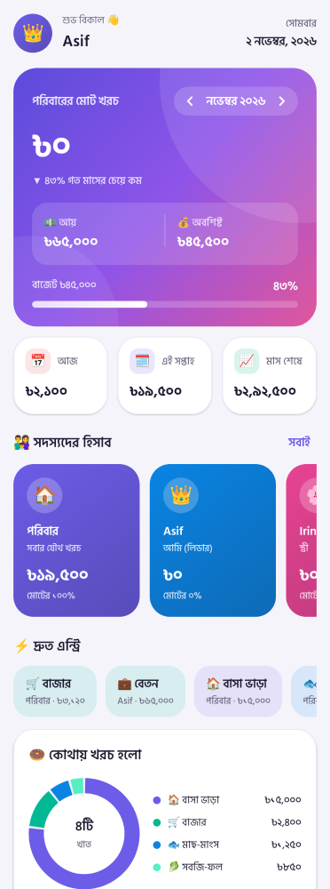
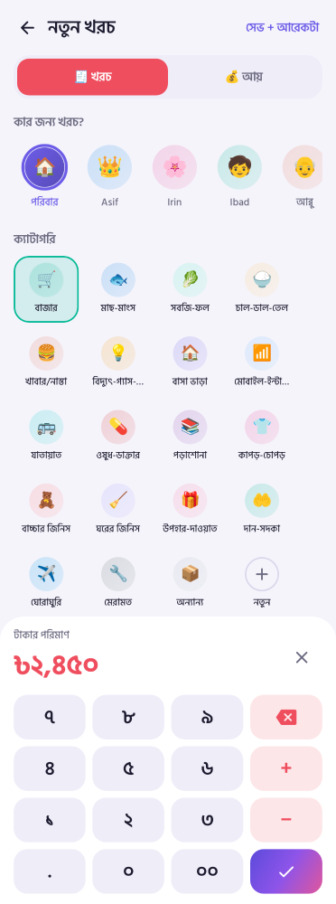
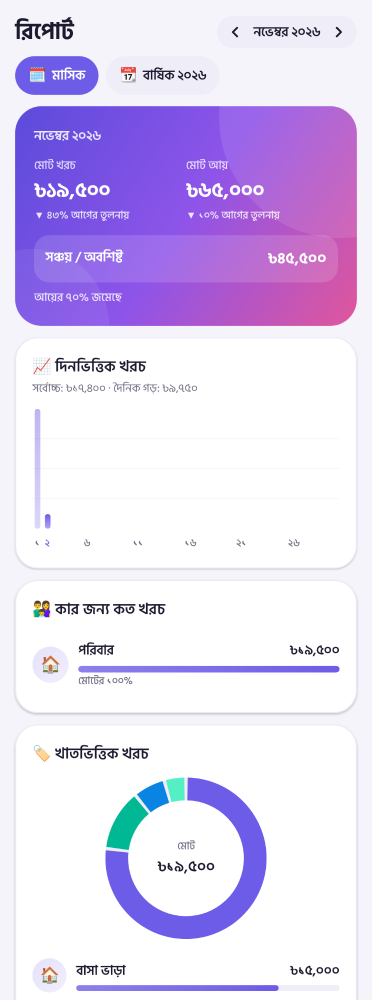
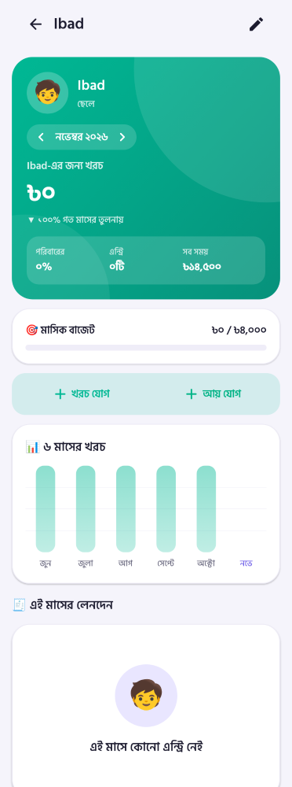

# 🏡 পরিবারের হিসাব (Family Hisab)

Asif-এর পরিবারের জন্য Android হিসাবের অ্যাপ। **লগইন নেই, সার্ভার নেই, ইন্টারনেট লাগে না** — সব হিসাব শুধু ফোনে থাকে। সব টাকা বাংলাদেশি টাকায় (৳)।

| হোম | এন্ট্রি | রিপোর্ট | সদস্য |
|---|---|---|---|
|  |  |  |  |

## ফিচার
- **ড্যাশবোর্ড** — মাসের মোট খরচ/আয়/অবশিষ্ট, বাজেট বার, আজ/এই সপ্তাহ/মাস শেষের অনুমান, সদস্যদের রঙিন কার্ড, খাতের ডোনাট চার্ট, ৬ মাসের চার্ট
- **সহজ এন্ট্রি** — বড় নাম্বার প্যাড (১২০+৮০+২৫০ যোগ করা যায়), এক ট্যাপে সদস্য ও ক্যাটাগরি, আজ/গতকাল/তারিখ, ক্যাশ/বিকাশ/নগদ/রকেট/ব্যাংক/কার্ড, “সেভ + আরেকটা”
- **বাজারের আইটেম** — চাল ৫ কেজি ৳৩৭৫… আলাদা দাম, মোট নিজে হয়; আগে কেনা আইটেম আগের দামসহ এক ট্যাপে
- **৫ সদস্য + পরিবার** — Asif, Irin, Ibad, আব্বু (Moslem Mia), আম্মু (Fazilatun Nessa) — প্রত্যেকের আলাদা হিসাব পেজ; যৌথ খরচ “পরিবার”-এ
- **লেনদেন** — খোঁজা (নোট/আইটেম/সদস্য/টাকা), খরচ/আয়/সদস্য/ক্যাটাগরি ফিল্টার, দিন অনুযায়ী সাজানো, এডিট/মুছা
- **রিপোর্ট** — মাসিক ও বার্ষিক, দিনভিত্তিক চার্ট, সদস্য ও খাত অনুযায়ী, আগের মাসের তুলনা, বাজারের আইটেম র‍্যাংকিং, সবচেয়ে বড় খরচ
- **বাজেট** — পুরো পরিবার, প্রতি সদস্য, প্রতি খাত
- **বাকি-ধার** — পাবো/দেবো, কিস্তিতে শোধ, ফোন কল
- **বাজার লিস্ট** — কী কিনতে হবে, টিক দিয়ে এক ট্যাপে খরচে যোগ
- **সঞ্চয় লক্ষ্য** — যেমন ঈদের কেনাকাটা, জমা/তোলা
- **এক্সপোর্ট / ইমপোর্ট** — পুরো ব্যাকআপ (JSON) সেভ/শেয়ার, Excel (CSV) এক্সপোর্ট, ব্যাকআপ থেকে ফিরিয়ে আনা (মিলিয়ে বা সব বদলে)
- লাইট/ডার্ক থিম, বাংলা/ইংরেজি সংখ্যা, Hind Siliguri ফন্ট, ক্যাটাগরি ও সদস্য নিজের মতো সাজানো

## বিল্ড
```bash
cd family-hisab
./gradlew assembleRelease     # APK: app/build/outputs/apk/release/app-release.apk
./gradlew testDebugUnitTest   # হিসাবের টেস্ট
./gradlew recordPaparazziDebug  # স্ক্রিনশট আবার তৈরি
```
Android Studio-তে `family-hisab` ফোল্ডারটা খুললেও চলবে।

### সাইনিং key (জরুরি)
আপডেট ইনস্টল করতে হলে প্রতিবার **একই key** লাগবে, নাহলে পুরোনো অ্যাপ মুছে নতুন দিতে হবে (ডাটা হারাবে)।
`hisab-release.jks` আর `keystore.properties` ফাইল দুটো `family-hisab/` ফোল্ডারে রাখুন — এগুলো git-এ যায় না, নিরাপদে ব্যাকআপ রাখুন।
ফাইল না থাকলে debug key দিয়ে সাইন হয়।

## কোড কাঠামো
```
app/src/main/java/com/asif/familyhisab/
├── MainActivity.kt
├── data/   Models, Defaults (সদস্য/ক্যাটাগরি), Calc (হিসাবের সূত্র), Store (JSON ফাইলে সেভ), Backup (JSON/CSV)
├── util/   Fmt — ৳ ফরম্যাট, বাংলা সংখ্যা, বাংলা মাস/দিন
└── ui/     App (ন্যাভিগেশন), theme, components (কার্ড, চার্ট), screens
```
টাকা সবসময় পয়সায় (`Long`) রাখা হয়, তাই দশমিকের কোনো ভুল হয় না।
